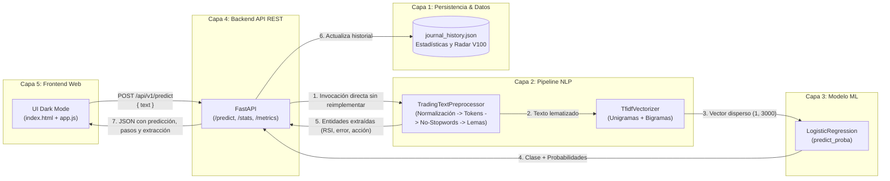

# TradingJournal NLP — Sistema de Análisis de Bitácoras, Estrategias y Errores de Trading

> **Materia:** Tópicos y Programación Avanzada | **Docente:** Ing. Kenji  
> **Repositorio Oficial:** `https://github.com/maykol-villazon-dev/trading-journal-nlp.git`  
> **Equipo de Desarrollo:** Maykol (DEV 1) & Oscar Cruz (DEV 2)  
> **Especialización de Dominio:** Mercados Sintéticos (Deriv Volatility 100, Volatility 75, Boom 1000, Crash 500 en MT5)

---

## 1. Visión y Propósito del Proyecto

En el trading sobre **mercados sintéticos (Deriv Volatility 100 / MetaTrader 5)**, los traders anotan en texto libre sus estrategias e incidencias operativas en su bitácora (_Trading Journal_). La mayoría de las pérdidas sostenidas no se deben a la falla del indicador técnico (`RSI`, `MACD`, `EMA`), sino a **errores de disciplina y psicología operativa**, tales como no esperar el cierre de la vela, operar sin Stop Loss o entrar por impulso (FOMO).

**TradingJournal NLP** es una plataforma web completa de 5 capas que procesa en español los registros libres de bitácoras, extrae entidades técnicas estructuradas y clasifica mediante Machine Learning en tres categorías diagnósticas:
- **`Ganadora_Disciplinada` (`#10b981`):** La operación respetó las confirmaciones y reglas de gestión de riesgo con resultado positivo.
- **`Riesgo_Neutral` (`#64748b`):** Operación cerrada en empate (*Break-Even*) o registro analítico sin sesgo definido.
- **`Perdedora_Error_Operativo` (`#ef4444`):** Operación perdedora desencadenada por una indisciplina técnica documentada.

---

## 2. Respuestas a las 3 Preguntas Centrales de la Defensa (Sección 2 del PDF)

### Pregunta 1: ¿Por qué se eligió este preprocesamiento de NLP?
1. **Conservación de Negaciones Operativas en Stop Words:** En una lista estándar en español, palabras como `"no"`, `"sin"` o `"nunca"` se eliminan. En trading, borrar `"no"` convierte *"no esperé el cierre de la vela"* en *"esperé el cierre de la vela"*, invirtiendo el sentido operativo. Nuestro pipeline protege obligatoriamente el conjunto `{"no", "sin", "ni", "nunca", "antes", "contra"}`.
2. **Normalización con Inyección Semántica:** Detecta niveles numéricos de indicadores técnicos (ej. `RSI < 30` inyecta `_nivel_sobreventa_`, `RSI > 70` inyecta `_nivel_sobrecompra_`) y traduce emojis de trading (`✅` -> `_emoji_ganancia_`, `❌` -> `_emoji_perdida_`).
3. **Lematización vs. Stemming:** La lematización convierte conjugaciones verbales irregulares del pasado a su infinitivo base (`"entré"` -> `"entrar"`, `"esperé"` -> `"esperar"`, `"perdiendo"` -> `"perder"`), normalizando las tildes finales y facilitando la visualización explicativa.
4. **N-gramas (1, 2) y Vectorización TF-IDF:** Los bigramas son críticos porque los errores de trading son sintagmas de dos palabras: `"no esperar"`, `"cierre vela"`, `"stop loss"`, `"sin stop"`, `"entrar compra"`. TF-IDF (`max_features=3000`, `sublinear_tf=True`) da un alto peso discriminativo a estos patrones.

---

### Pregunta 2: ¿Por qué se eligieron estos 2 modelos frente a los 8 vistos en clase?
De los 8 modelos vistos en clase (*Regresión Lineal, Regresión Logística, Naive Bayes, KNN, K-Means, Árbol de Decisión, Random Forest y XGBoost*):

| Modelo | Estado | Justificación Técnica |
| :--- | :--- | :--- |
| **1. Regresión Logística (`LogisticRegression`)** | **ELEGIDO (Producción)** | Óptimo para matrices dispersas TF-IDF con bigramas. Maneja desbalance con `class_weight='balanced'`, entrega probabilidades calibradas y permite auditar pesos por token. |
| **2. Naive Bayes (`MultinomialNB`)** | **ELEGIDO (Baseline)** | Modelo probabilístico de referencia para texto. Permite comparar cómo afecta la hipótesis de independencia condicional frente a Regresión Logística. |
| **3. Regresión Lineal** | Descartado | Predice valores continuos no acotados; no clasifica probabilidades de clases discretas. |
| **4. K-Means** | Descartado | Agrupamiento no supervisado sin etiquetas; no clasifica diagnóstico ni errores. |
| **5. KNN (K-Nearest Neighbors)** | Descartado | Sufre la maldición de la dimensionalidad en 3,000 dimensiones TF-IDF y es lento en inferencia. |
| **6. Árbol de Decisión** | Descartado | Sobreajusta fácilmente a palabras aisladas en matrices de texto de alta dispersión. |
| **7. Random Forest** | Descartado | Mayor consumo de memoria y tiempo sin superar a los modelos lineales regularizados en texto corto. |
| **8. XGBoost** | Descartado | Alto costo de ajuste para un rendimiento marginal sobre Regresión Logística en este tamaño de corpus. |

---

### Pregunta 3: ¿Cómo llega una predicción desde el Frontend hasta el Modelo y de vuelta? (Las 5 Capas)



1. **Frontend (`Capa 5`):** El usuario ingresa la bitácora (ej. *"Entré en compra cuando el RSI estaba en 28, pero no esperé el cierre de la vela y terminé perdiendo"*) y envía `POST /api/v1/predict`.
2. **Backend FastAPI (`Capa 4`):** Valida con Pydantic (rechaza textos vacíos, de menos de 3 palabras o más de 1000 caracteres).
3. **Pipeline NLP (`Capa 2`):** El backend invoca el pipeline serializado en `models_prod/pipeline_prod.joblib` (sin reimplementar código), ejecutando normalización, tokenización, filtrado conservando `"no"`, lematización y extracción de bigramas activos.
4. **Inferencia ML (`Capa 3`):** El clasificador calcula las probabilidades y asigna la clase diagnóstica (`Perdedora_Error_Operativo`, confianza: 91%).
5. **Persistencia (`Capa 1`):** Se guarda el registro en `data/processed/journal_history.json` para alimentar en tiempo real el radar de Volatility 100.
6. **Respuesta al Usuario:** El frontend actualiza los chips visuales del pipeline, la tarjeta de diagnóstico, el radar y el ranking de errores operativos.

---

## 3. Arquitectura del Proyecto

```text
trading-journal-nlp/
├── data/
│   ├── download_dataset.py       # Generador/descargador reproducible del corpus (Dev 1)
│   ├── raw/                      # Dataset crudo 2,100 registros trading_journal_es.csv
│   └── processed/                # train.csv (80%), test.csv (20%) y journal_history.json
├── notebooks/
│   └── 01_eda_experimentos.ipynb # EDA, desbalance, nulos, Stemming vs Lemma, N-gramas (Dev 1)
├── src/
│   ├── __init__.py
│   ├── nlp/
│   │   ├── __init__.py
│   │   ├── preprocessor.py       # TradingTextPreprocessor + extract_trading_entities (Dev 1)
│   │   └── vectorizer.py         # TF-IDF con bigramas y extractor de pesos activos (Dev 2)
│   └── models/
│       ├── __init__.py
│       ├── train.py              # Script único reproducible de entrenamiento y serialización (Dev 1)
│       └── evaluate.py           # Métricas, matriz confusión, 3 errores y stats de trading (Dev 2)
├── api/
│   ├── __init__.py
│   ├── main.py                   # Servidor FastAPI + lifespan de carga única (Dev 2)
│   ├── schemas.py                # Modelos Pydantic v2 + validaciones de entrada (Dev 2)
│   └── routes.py                 # Endpoints /health, /predict, /stats, /metrics (Dev 2)
├── frontend/
│   ├── index.html                # UI Dark Mode Trading Journal & Dashboard V100 (Dev 2)
│   ├── app.js                    # Consumo de API, visualizador NLP y actualización de KPIs (Dev 2)
│   └── styles.css                # Estilos estilo MetaTrader 5 y Deriv (Dev 2)
├── models_prod/                  # Artefactos serializados (.joblib y .json)
│   ├── pipeline_prod.joblib
│   ├── pipeline_nb.joblib
│   └── metrics_report.json
├── tests/
│   └── test_api.py               # Suite automatizada de pruebas con pytest (Dev 2)
├── docs/
│   └── informe_tecnico.md        # Informe técnico completo y declaración de IA (Dev 1)
├── requirements.txt              # Dependencias fijadas (==)
├── README.md                     # Manual operativo de ejecución
└── CONTRIBUCIONES.md             # Trazabilidad de commits y roles por integrante
```

---

## 4. Instrucciones de Instalación y Ejecución Paso a Paso

### 1. Clonar el repositorio y acceder a la carpeta
```bash
git clone https://github.com/maykol-villazon-dev/trading-journal-nlp.git
cd trading-journal-nlp
```

### 2. Crear y activar entorno virtual
```bash
# En Windows (PowerShell):
python -m venv venv
.\venv\Scripts\Activate.ps1

# En Linux / macOS:
python3 -m venv venv
source venv/bin/activate
```

### 3. Instalar dependencias fijadas
```bash
pip install -r requirements.txt
```

### 4. Entrenar el Pipeline y Generar Modelos (1 solo comando reproducible)
```bash
python src/models/train.py
```
> Ejecuta la partición estratificada 80/20, corre los experimentos de ablación (Stemming vs Lemma, Unigramas vs Bigramas), ajusta `MultinomialNB` y `LogisticRegression` con validación cruzada de 5 pliegues y guarda los artefactos en `models_prod/`.

### 5. Ejecutar Pruebas Automatizadas
```bash
python -m pytest tests/ -v
```

### 6. Iniciar el Backend API (Puerto 8000)
```bash
python -m uvicorn api.main:app --reload --port 8000
```
- Documentación interactiva Swagger: `http://localhost:8000/docs`
- Estado del servicio: `http://localhost:8000/api/v1/health`

### 7. Iniciar el Frontend Web (Puerto 3000)
En una nueva terminal:
```bash
python -m http.server 3000 --directory frontend
```
- Abrir en el navegador: `http://localhost:3000`

---

## 5. Documentación de la API REST

### `GET /api/v1/health`
Verifica el estado del servicio, versión y modelo cargado en memoria.

### `POST /api/v1/predict`
Recibe una bitácora en español y ejecuta las 5 capas del sistema.

**Cuerpo de la Petición:**
```json
{
  "text": "Entré en compra cuando el RSI estaba en 28, pero no esperé el cierre de la vela y terminé perdiendo"
}
```

**Respuesta Exitosa (HTTP 200):**
```json
{
  "status": "success",
  "text": "Entré en compra cuando el RSI estaba en 28, pero no esperé el cierre de la vela y terminé perdiendo",
  "prediction": "Perdedora_Error_Operativo",
  "probabilities": {
    "Ganadora_Disciplinada": 0.0321,
    "Riesgo_Neutral": 0.0514,
    "Perdedora_Error_Operativo": 0.9165
  },
  "confidence": 0.9165,
  "extracted_trading_info": {
    "indicator": "RSI (Nivel 28 - Sobreventa)",
    "indicator_code": "RSI",
    "action": "Compra (BUY)",
    "market": "Volatility 100",
    "timeframe": "M5",
    "operational_error": "No esperar cierre de vela",
    "outcome_detected": "Pérdida (Loss)"
  },
  "pipeline_steps": {
    "raw_text": "...",
    "normalized": "entré en compra cuando el rsi estaba en 28 _nivel_sobreventa_ pero no esperé el cierre de la vela y terminé perdiendo",
    "tokens": ["entré", "en", "compra", "cuando", "el", "rsi", "estaba", "en", "28", "_nivel_sobreventa_", "pero", "no", "esperé", "el", "cierre", "de", "la", "vela", "y", "terminé", "perdiendo"],
    "stopwords_removed": ["entré", "compra", "rsi", "28", "_nivel_sobreventa_", "no", "esperé", "cierre", "vela", "terminé", "perdiendo"],
    "kept_negations": ["no"],
    "lemmatized_or_stemmed": ["entrar", "compra", "rsi", "28", "_nivel_sobreventa_", "no", "esperar", "cierre", "vela", "terminar", "perder"],
    "top_tfidf_features": [
      { "term": "rsi 28", "weight": 0.403 },
      { "term": "no esperar", "weight": 0.228 }
    ],
    "active_mode": "lemma"
  },
  "inference_time_ms": 3.82,
  "saved_to_history": true
}
```

### `GET /api/v1/stats`
Devuelve el ranking de errores operativos más frecuentes, efectividad por indicador (`RSI`, `MACD`, `EMA`) y el radar algorítmico de **Deriv Volatility 100**.

### `GET /api/v1/metrics`
Devuelve el reporte completo serializado: comparativa de modelos, experimentos de ablación, matrices de confusión y análisis de 3 casos reales de error.

---

## 6. Guía Rápida para la Modificación en Vivo (15 Puntos Individuales)

| Modificación solicitada por el Ing. Kenji | Archivo a modificar | Cómo ejecutar el cambio en menos de 1 minuto |
| :--- | :--- | :--- |
| **"Cambiar la validación para rechazar menos de 5 palabras"** | `api/schemas.py` | Modificar `MIN_WORDS = 5` en la línea 18. Probar en `/docs` enviando 3 palabras y verificar HTTP 422. |
| **"Cambiar el rango de n-gramas a unigramas (1,1)"** | `src/nlp/vectorizer.py` | Modificar `ngram_range=(1, 1)` en `build_tfidf_vectorizer`. Ejecutar `python src/models/train.py`. |
| **"Cambiar Lematización por Stemming y reentrenar"** | `src/models/train.py` | Modificar `DEFAULT_NLP_MODE = "stem"` en la línea 62. Ejecutar `python src/models/train.py`. |
| **"Agregar o quitar una palabra protegida de stop words"** | `src/nlp/preprocessor.py` | Comentar `"no"` en `NEGATION_AND_TRADING_KEEP` (línea 51) para demostrar cómo deja de detectar el error. |
| **"Calcular e interpretar una métrica adicional por clase"** | `src/models/evaluate.py` | Ya incluye `error_rate = 1.0 - recall` en `per_class`. Ejecutar `python src/models/evaluate.py`. |
| **"Mostrar un dato nuevo en el Frontend"** | `frontend/app.js` | Modificar `renderPredictionResults` para mostrar el conteo de stop words descartadas o el ratio de probabilidades. |
