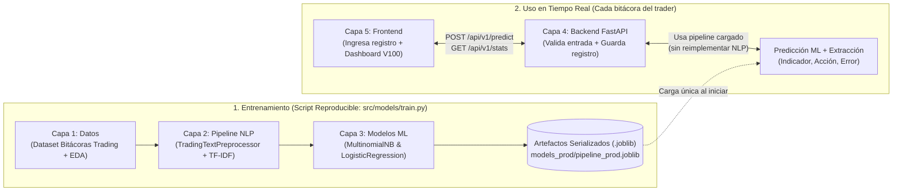

# PROYECTO INTEGRADOR: TradingJournal NLP — Sistema de Análisis de Bitácoras, Estrategias y Errores de Trading (Deriv Volatility 100)

**Materia:** Tópicos y Programación Avanzada | **Docente:** Ing. Kenji  
**Repositorio Oficial:** `https://github.com/maykol-villazon-dev/trading-journal-nlp.git`  
**Plazo restante:** ~12 Horas | **Equipo:** 2 Desarrolladores (Dev 1: Maykol | Dev 2: Oscar Cruz)  
**Modalidad de evaluación:** Parte Grupal (40 pts) + Parte Individual (60 pts: Commits 20 pts + Explicación 15 pts + Preguntas 10 pts + Modificación en vivo 15 pts).

---

## 1. Visión, Propósito y Tema Aprobado por el Docente

### 1.1 El Problema de Negocio (Aprobado por el Ing. Kenji)

En el trading algorítmico y manual sobre **mercados sintéticos (Deriv Volatility 100, Volatility 75, Boom & Crash en MT5)**, los traders dependen exclusivamente del **análisis técnico** (indicadores como `RSI`, `MACD`, `EMA`, `Bandas de Bollinger` y acción del precio/cierre de velas). Sin embargo, la mayoría de las pérdidas no ocurren porque falle el indicador matemático, sino por **errores operativos y de disciplina** que el trader anota en texto libre en su bitácora (_Trading Journal_), tales como entrar antes del cierre de la vela, no colocar Stop Loss o entrar por impulso (FOMO).

**TradingJournal NLP** es una plataforma web completa de 5 capas que procesa en español los **registros de operaciones y estrategias de trading**, aplica un pipeline completo de NLP + extracción de información + clasificación con Machine Learning y convierte el texto libre en **datos estructurados** para:

1. **Extraer automáticamente del texto:**
   - **Indicador técnico y nivel:** ej. `RSI (28)`, `EMA 200`, `MACD`, `Bollinger`, `Soporte/Resistencia`.
   - **Acción realizada:** `Compra (Buy / Long)` o `Venta (Sell / Short)`.
   - **Activo / Mercado sintético:** `Volatility 100 (V100)`, `Volatility 75 (V75)`, `Boom 1000`, `Crash 500`.
   - **Error operativo detectado:** ej. `No esperar cierre de vela`, `Operar sin Stop Loss`, `Mover el Stop Loss`, `FOMO / Entrada anticipada`, `Sobreoperar (Overtrading)` o `Ejecución disciplinada (Sin error)`.
2. **Clasificar con Machine Learning (2 modelos comparados):**
   - **`Ganadora_Disciplinada` (Resultado Positivo / Ejecución Correcta):** El trader respetó sus confirmaciones técnicas y obtuvo ganancia (`#10b981`).
   - **`Riesgo_Neutral` (Break-Even / Señal Mixta):** Operación cerrada en empate o registro de análisis técnico sin desencadenante claro (`#64748b`).
   - **`Perdedora_Error_Operativo` (Resultado Negativo / Error Operativo):** Operación perdedora causada por violar reglas técnicas o de gestión de riesgo (`#ef4444`).
3. **Almacenar la información estructurada y generar estadísticas predictivas:**
   - Registra cada operación analizada para calcular **estadísticas sobre errores frecuentes**, efectividad (_Winrate_) por indicador técnico (`RSI`, `MACD`, `EMA`) y emitir alertas preventivas que complementan el análisis técnico en **Volatility 100**.

> **Ejemplo central acordado con el docente:**
>
> - **Texto del usuario:** _"Entré en compra cuando el RSI estaba en 28, pero no esperé el cierre de la vela y terminé perdiendo"_
> - **Extracción estructurada:** Indicador: `RSI (nivel 28)` | Acción: `Compra` | Error operativo: `No esperar cierre de la vela`
> - **Clasificación del modelo ML:** `Perdedora_Error_Operativo` (Probabilidad: 91%).

---

### 1.2 Justificación de las 3 Preguntas Centrales del Docente (Sección 2 del PDF)

#### Pregunta 1: ¿Por qué se eligió este preprocesamiento de NLP?

En bitácoras de trading técnico, un preprocesamiento estándar eliminaría niveles numéricos de indicadores (`RSI 28`, `EMA 50`) y borraría la palabra `"no"`, destruyendo por completo la detección de errores operativos (_"esperé el cierre de la vela"_ vs _"no esperé el cierre de la vela"_). Por eso diseñamos cada etapa así:

1. **Normalización selectiva (Minúsculas, Tildes, Puntuación, Números, URLs y Emojis):**
   - **Minúsculas:** Unifica `"Compra"`, `"COMPRA"` y `"compra"`, o `"Vela"` y `"vela"`.
   - **URLs y ruido:** Elimina enlaces a capturas de TradingView/MT5 (`https://...`) y signos de puntuación decorativos (`¡!`, `,`, `.`).
   - **Números y Niveles Técnicos (Conservados semánticamente):** En lugar de borrar todos los números, identificamos niveles de sobreventa/sobrecompra del RSI (`RSI < 30` -> `_nivel_sobreventa_`, `RSI > 70` -> `_nivel_sobrecompra_`), temporalidades (`M1`, `M5`, `H1`) y activos sintéticos (`Volatility 100` / `V100` -> `volatility_100`).
   - **Emojis de Trading:** Conserva emojis que los traders usan en sus bitácoras (`✅`, `🟢`, `🚀` -> `_emoji_ganancia_`; `❌`, `🔴`, `📉` -> `_emoji_perdida_`) y elimina emojis irrelevantes.
   - **Tildes:** Se mantienen durante el análisis morfológico (para distinguir `"entré"` pasado de `"entre"` preposición) y se normalizan al final sobre los lemas para que textos escritos rápido sin tilde (`"perdida"`, `"analisis"`, `"entre"`) coincidan con `"pérdida"` y `"análisis"`.
2. **Tokenización de dominio de Trading:**
   - Conserva intactos acrónimos técnicos (`rsi`, `macd`, `ema`, `sl`, `tp`, `fomo`, `mt5`, `v100`) y tokens semánticos compuestos (`_nivel_sobreventa_`).
3. **Stop Words adaptadas (Conservando Negaciones y Condicionales Operativos):**
   - Se eliminan artículos y conectores vacíos (`"cuando"`, `"el"`, `"en"`, `"de"`, `"la"`, `"y"`), pero **se prohíbe eliminar** palabras de negación u omisión (`"no"`, `"sin"`, `"ni"`, `"nunca"`, `"antes"`, `"tampoco"`, `"contra"`). Sin el `"no"`, la frase _"no esperé el cierre de la vela"_ perdería la señal exacta del error operativo.
4. **Stemming (`SnowballStemmer`) vs. Lematización (`SpaCy es_core_news_sm`):**
   - Implementamos ambos y comparamos su efecto en el F1-Score. El **Stemming** corta raíces de forma agresiva (`"perdiendo"` -> `"perd"`, `"esperé"` -> `"esper"`), mientras que la **Lematización** lleva las conjugaciones verbales a su infinitivo real (`"entré"` -> `"entrar"`, `"esperé"` -> `"esperar"`, `"perdiendo"` -> `"perder"`), lo que hace mucho más claro el visualizador paso a paso del Frontend y agrupa mejor las acciones del trader.
5. **N-gramas `(1, 1)` vs `(1, 2)` y Vectorización TF-IDF:**
   - Los **bigramas `(1, 2)`** son indispensables en trading porque los errores operativos son frases de 2 palabras: `"no esperar"`, `"cierre vela"`, `"sin stop"`, `"stop loss"`, `"entrar compra"`, `"contra tendencia"`.
   - **TF-IDF (`max_features=3000`, `min_df=2`, `max_df=0.85`, `ngram_range=(1,2)`, `sublinear_tf=True`):** Da alto peso matemático a combinaciones específicas de indicadores y errores operativos, y reduce el peso de términos genéricos.

---

#### Pregunta 2: ¿Por qué se eligieron estos 2 modelos frente a los 8 vistos en clase?

En la materia se vieron **8 modelos**: _Regresión Lineal, Regresión Logística, Naive Bayes, KNN, K-means, Árbol de Decisión, Random Forest y XGBoost_.

| Modelo visto en clase                             | Tipo de tarea               | ¿Por qué se elige o se descarta en nuestro sistema de Trading NLP?                                                                                                                                                                                                                                                                                                                        |
| :------------------------------------------------ | :-------------------------- | :---------------------------------------------------------------------------------------------------------------------------------------------------------------------------------------------------------------------------------------------------------------------------------------------------------------------------------------------------------------------------------------- |
| **1. Regresión Logística (`LogisticRegression`)** | Clasificación supervisada   | **ELEGIDO (Producción):** En matrices TF-IDF dispersas con bigramas (`"no esperar"`, `"cierre vela"`), optimiza directamente los pesos discriminativos sin asumir independencia entre palabras. Entrega probabilidades calibradas (`predict_proba`), maneja desbalance (`class_weight='balanced'`) y permite auditar qué bigramas empujan una operación hacia pérdida o ganancia.         |
| **2. Naive Bayes (`MultinomialNB`)**              | Clasificación supervisada   | **ELEGIDO (Baseline Comparativo):** Modelo probabilístico clásico para texto TF-IDF. Es ideal para comparar con Regresión Logística: cuando una bitácora tiene una buena señal (`"rsi sobreventa compra"`) pero un error (`"no esperar cierre vela"`), Naive Bayes a veces duda por asumir independencia condicional, mientras que Regresión Logística pondera mejor el bigrama de error. |
| **3. Regresión Lineal**                           | Regresión continua          | **Descartado:** Predice valores continuos no acotados, no probabilidades de clases discretas.                                                                                                                                                                                                                                                                                             |
| **4. K-Means**                                    | Agrupamiento no supervisado | **Descartado:** Agrupa sin etiquetas; nosotros necesitamos diagnosticar con precisión supervisada el resultado y error operativo.                                                                                                                                                                                                                                                         |
| **5. KNN (K-Nearest Neighbors)**                  | Clasificación supervisada   | **Descartado:** Sufre la maldición de la dimensionalidad en 3,000 columnas TF-IDF y es costoso en memoria/tiempo al predecir en vivo.                                                                                                                                                                                                                                                     |
| **6. Árbol de Decisión**                          | Clasificación supervisada   | **Descartado:** Un solo árbol sobre miles de tokens TF-IDF sobreajusta (_overfitting_) a palabras sueltas y pierde generalización.                                                                                                                                                                                                                                                        |
| **7. Random Forest**                              | Clasificación supervisada   | **Descartado:** En matrices dispersas de texto corto, el muestreo aleatorio de columnas genera árboles débiles y un modelo pesado sin superar a Regresión Logística.                                                                                                                                                                                                                      |
| **8. XGBoost**                                    | Clasificación supervisada   | **Descartado como primario:** Mayor costo computacional de entrenamiento/ajuste en matrices TF-IDF dispersas para un rendimiento similar al modelo lineal regularizado.                                                                                                                                                                                                                   |

---

#### Pregunta 3: ¿Cómo llega una predicción desde el Frontend hasta el Modelo y de vuelta? (Las 5 Capas)

Cumpliendo el diagrama de la **Sección 5 y 5.4 del PDF** (_"El script de entrenamiento guarda el pipeline y los modelos; el backend los carga y nunca reimplementa el preprocesamiento"_):



1. **Frontend (`Capa 5`):** El trader ingresa su registro (ej. _"Entré en compra cuando el RSI estaba en 28, pero no esperé el cierre de la vela y terminé perdiendo"_) y envía `POST /api/v1/predict`.
2. **Backend (`Capa 4`):** FastAPI valida con **Pydantic** que el texto no esté vacío, tenga al menos 3 palabras y no exceda 1,000 caracteres.
3. **Pipeline de NLP y Extracción (`Capa 2` cargada desde `models_prod/pipeline_prod.joblib`):**
   - El backend invoca `preprocessor.explain_steps(text)` del objeto cargado en memoria (sin reimplementar código en la API), obteniendo:
     - Los 5 pasos del texto: `raw_text` -> `normalized` -> `tokens` -> `stopwords_removed` -> `lemmatized_or_stemmed`.
     - La extracción estructurada (`extracted_info`): **Indicador** (`RSI (28)`), **Acción** (`Compra`), **Mercado** (`Volatility 100 / General`), **Error operativo** (`No esperar cierre de vela`).
4. **Inferencia del Modelo (`Capa 3`):** El mismo pipeline transforma los lemas con el `TfidfVectorizer` entrenado y ejecuta `LogisticRegression.predict_proba()`, devolviendo la clase (`Perdedora_Error_Operativo`, `Ganadora_Disciplinada` o `Riesgo_Neutral`) y sus probabilidades.
5. **Persistencia de Estadísticas y Respuesta al Frontend:** El backend registra la operación estructurada en el historial estadístico (`data/processed/journal_history.json`) y devuelve todo al Frontend, que actualiza el visualizador NLP, la tarjeta de diagnóstico y los gráficos de estadísticas de errores frecuentes.

---

## 2. Requisitos Técnicos Obligatorios Alineados al PDF y al Caso de Trading

### A. Capa 1: Datos y Análisis Exploratorio (Sección 4 y 5.1 del PDF)

- **Origen, Licencia y Fecha de Obtención:**
  - **Fuente:** Corpus sintético-curado y estructurado de **2,100 registros de bitácoras de trading y análisis técnico en español** (operaciones en _Deriv Volatility 100, Volatility 75, Boom 1000, Crash 500, BTC/USD_, combinando indicadores `RSI`, `MACD`, `EMA`, `Bollinger`, `Soporte/Resistencia`, `Fibonacci`, acciones de `compra/venta` y errores operativos reales documentados en literatura de psicotrading y acción del precio), generado y descargado de forma 100% reproducible mediante `data/download_dataset.py`.
  - **Licencia:** MIT Open Educational Dataset.
  - **Fecha de obtención/generación:** 2 de noviembre de 2026.
- **Análisis Exploratorio en `notebooks/01_eda_experimentos.ipynb`:**
  1. Verificación de **valores faltantes (`isnull`) y duplicados**.
  2. **Distribución de las 3 clases** (`Ganadora_Disciplinada`, `Perdedora_Error_Operativo`, `Riesgo_Neutral`) y **tratamiento justificado del desbalance** (`stratify=y` y `class_weight='balanced'`).
  3. Distribución de **longitud de los textos** (en caracteres y palabras) y frecuencia de indicadores técnicos (`RSI`, `EMA`, `MACD`) y errores operativos.
  4. **Palabras y bigramas más frecuentes** por clase.
  5. **Partición 80% entrenamiento / 20% prueba** estratificada con semilla fija (`random_state=42`).

---

### B. Capa 2: Pipeline de NLP Paso a Paso con Ejemplo Antes/Después (Sección 5.2 del PDF)

| Paso (Sección 5.2 PDF)           | Qué exige el PDF                                                                                    | Ejemplo Real (Caso Oscar + Ing. Kenji)                                                                                                                                                                                                                                                          | Justificación Técnica en Trading                                                                                                                                                                                                          |
| :------------------------------- | :-------------------------------------------------------------------------------------------------- | :---------------------------------------------------------------------------------------------------------------------------------------------------------------------------------------------------------------------------------------------------------------------------------------------- | :---------------------------------------------------------------------------------------------------------------------------------------------------------------------------------------------------------------------------------------- |
| **1. Normalización**             | Minúsculas, tildes, puntuación, números, URLs y emojis; justificar qué se elimina y qué se conserva | **Antes:** `"Entré en compra cuando el RSI estaba en 28, pero no esperé el cierre de la vela y terminé perdiendo ❌"`<br>**Después:** `"entré en compra cuando el rsi estaba en 28 _nivel_sobreventa_ pero no esperé el cierre de la vela y terminé perdiendo _emoji_perdida_"`                 | Convierte a minúsculas, elimina puntuación (`,`), conserva números asociados a niveles de indicadores (`28` junto a `rsi` inyecta `_nivel_sobreventa_`) y traduce emojis operativos (`❌` -> `_emoji_perdida_`).                          |
| **2. Tokenización**              | Separar el texto en tokens; mostrar casos difíciles del dominio                                     | `["entré", "en", "compra", "cuando", "el", "rsi", "estaba", "en", "28", "_nivel_sobreventa_", "pero", "no", "esperé", "el", "cierre", "de", "la", "vela", "y", "terminé", "perdiendo", "_emoji_perdida_"]`                                                                                      | Preserva siglas técnicas (`rsi`, `macd`, `ema`, `v100`, `sl`, `tp`), niveles numéricos y tokens semánticos con guion bajo.                                                                                                                |
| **3. Stop words**                | Lista en español; justificar palabras agregadas o quitadas (ej. la negación `"no"`)                 | `["entré", "compra", "rsi", "28", "_nivel_sobreventa_", "no", "esperé", "cierre", "vela", "terminé", "perdiendo", "_emoji_perdida_"]`                                                                                                                                                           | Se eliminan conectores vacíos (`"en"`, `"cuando"`, `"el"`, `"estaba"`, `"pero"`, `"de"`, `"la"`, `"y"`), pero **se conserva obligatoriamente `"no"`** (y `"sin"`, `"antes"`, `"contra"`), porque `"no esperé"` define el error operativo. |
| **4. Stemming vs. Lematización** | Implementar ambos y comparar su efecto en las métricas para elegir uno                              | **Stemming:** `["entr", "compr", "rsi", "28", "_nivel_sobrevent_", "no", "esper", "cierr", "vel", "termin", "perd", "_emoji_perd_"]`<br>**Lematización:** `["entrar", "compra", "rsi", "28", "_nivel_sobreventa_", "no", "esperar", "cierre", "vela", "terminar", "perder", "_emoji_perdida_"]` | La lematización convierte conjugaciones pasadas y gerundios (`"entré"` -> `"entrar"`, `"esperé"` -> `"esperar"`, `"perdiendo"` -> `"perder"`) en sus verbos base legibles y normaliza tildes finales. Se comparan ambos en F1-Score.      |
| **5. N-gramas**                  | Comparar al menos unigramas `(1,1)` contra unigramas + bigramas `(1,2)`                             | **Bigramas clave generados:** `"entrar compra"`, `"no esperar"`, `"esperar cierre"`, `"cierre vela"`, `"terminar perder"`                                                                                                                                                                       | Un unigrama suelto ve `"esperar"` y `"cierre"` como positivos; el bigrama `"no esperar"` + `"cierre vela"` captura exactamente la indisciplina del trader.                                                                                |
| **6. TF-IDF**                    | Vectorización con parámetros documentados                                                           | Vector disperso `(1, 3000)` con altos pesos en `"no esperar"`, `"cierre vela"`, `"rsi"`, `"perder"`                                                                                                                                                                                             | `max_features=3000`, `min_df=2`, `max_df=0.85`, `ngram_range=(1,2)`, `sublinear_tf=True`.                                                                                                                                                 |

---

### C. Capa 3: Modelos de Machine Learning y Pipeline Reproducible (Sección 5.3 y 5.4 del PDF)

- **Comparativa de 2 modelos:** `MultinomialNB` vs `LogisticRegression` ajustados con `GridSearchCV` (5-fold Stratified CV).
- **Métricas obligatorias:** Accuracy, Precision, Recall, F1-Score (Macro y por clase) y Matrices de Confusión.
- **Análisis de errores:** 3 casos reales del conjunto de prueba donde el modelo se equivoca (ej. el trader cometió un error operativo como no esperar confirmación, pero tuvo suerte por un spike en Volatility 100 y terminó ganando).
- **Un solo comando reproducible:** `python src/models/train.py` genera los datos, corre las comparativas (Stemming vs Lemma, Unigramas vs Bigramas, Naive Bayes vs Regresión Logística) y guarda los artefactos `.joblib` en `models_prod/`.

---

### D. Capa 4: Backend API REST con FastAPI (Sección 5.5 del PDF)

- `GET /api/v1/health`: Estado del servicio y modelo cargado.
- `POST /api/v1/predict`:
  - Valida entradas (rechaza texto vacío, menos de 3 palabras o más de 1,000 caracteres con error HTTP claro).
  - Devuelve:
    - `prediction` y `probabilities` (`Ganadora_Disciplinada`, `Riesgo_Neutral`, `Perdedora_Error_Operativo`).
    - `pipeline_steps` (texto crudo, normalizado, tokens, sin stop words, lematizado y top términos TF-IDF).
    - `extracted_trading_info`: `{ "indicator": "RSI (28 - Sobreventa)", "action": "Compra (BUY)", "market": "Volatility 100", "operational_error": "No esperar cierre de vela", "outcome_detected": "Pérdida" }`.
    - Guarda el registro estructurado para alimentar las estadísticas en vivo.
- `GET /api/v1/stats`: Devuelve las estadísticas acumuladas de las bitácoras procesadas (frecuencia de cada error operativo, tasa de éxito por indicador técnico `RSI`, `MACD`, `EMA`, `Bollinger`, y recomendaciones para **Volatility 100**).
- `GET /api/v1/metrics`: Devuelve la tabla comparativa de modelos, matrices de confusión, ablación de NLP (Stemming vs Lemma, N-gramas) y los 3 casos de análisis de errores.

---

### E. Capa 5: Frontend Web — Trading Journal & Volatility 100 Radar (Sección 5.6 del PDF)

- **Componente 1 (Input de Bitácora de Trading):** Caja de texto con ejemplos precargados (incluyendo el ejemplo exacto de Oscar del `RSI en 28 sin esperar cierre de vela`, una entrada ganadora en `Volatility 100 con EMA + MACD`, y una operación en `Break-Even`).
- **Componente 2 (Extracción Estructurada + Diagnóstico ML):** Tarjetas que muestran el **Indicador Detectado**, **Acción (Compra/Venta)**, **Error Operativo Identificado**, **Resultado / Probabilidad del Modelo** y alerta técnica para **Deriv Volatility 100**.
- **Componente 3 (Vista del Pipeline de NLP Paso a Paso):** Chips interactivos Antes/Después mostrando Normalización -> Tokenización -> Stop Words (resaltando en amarillo que `"no"` fue conservado) -> Lematización -> Pesos TF-IDF.
- **Componente 4 (Estadísticas de Errores Operativos + Métricas de Modelos):**
  - Gráfico de errores operativos más frecuentes del trader y rendimiento por indicador (`RSI`, `MACD`, `EMA`).
  - Tabla comparativa `LogisticRegression` vs `MultinomialNB`, Stemming vs Lematización, Matrices de Confusión y Análisis de Errores.

---

## 3. Estructura del Repositorio y División de Trabajo (DEV 1 y DEV 2)

### 3.1 Estructura de Directorios (`trading-journal-nlp`)

```text
trading-journal-nlp/
├── data/
│   ├── download_dataset.py       # Script reproducible de generación/descarga del corpus (Dev 1)
│   ├── raw/                      # Dataset crudo trading_journal_es.csv (origen, licencia y fecha)
│   └── processed/                # train.csv (80%), test.csv (20%) y journal_history.json
├── notebooks/
│   └── 01_eda_experimentos.ipynb # EDA, nulos, desbalance, Stemming vs Lemma, N-gramas (Dev 1)
├── src/
│   ├── __init__.py
│   ├── nlp/
│   │   ├── __init__.py
│   │   ├── preprocessor.py       # Normalización, tokens, stopwords, stem/lemma y extractor RSI/errores (Dev 1)
│   │   └── vectorizer.py         # Configuración TF-IDF y extractor de pesos por bigrama (Dev 2)
│   └── models/
│       ├── __init__.py
│       ├── train.py              # Entrenamiento reproducible, GridSearchCV y serialización .joblib (Dev 1)
│       └── evaluate.py           # Cálculo de métricas, matriz de confusión, 3 errores y stats (Dev 2)
├── api/
│   ├── __init__.py
│   ├── main.py                   # Servidor FastAPI + lifespan de carga de artefactos (Dev 2)
│   ├── schemas.py                # Modelos Pydantic + validaciones de entrada (Dev 2)
│   └── routes.py                 # Endpoints /predict, /stats, /metrics, /health (Dev 2)
├── frontend/
│   ├── index.html                # UI Trading Journal & Volatility 100 Dashboard (Dev 2)
│   ├── app.js                    # Consumo de API, visualizador NLP y gráficos de errores (Dev 2)
│   └── styles.css                # Estilos Dark Mode tipo MT5 / Deriv (Dev 2)
├── models_prod/                  # Artefactos serializados generados por train.py
│   ├── pipeline_prod.joblib
│   ├── pipeline_nb.joblib
│   └── metrics_report.json
├── tests/
│   └── test_api.py               # Pruebas automatizadas de API y del pipeline NLP (Dev 1 & Dev 2)
├── docs/
│   ├── informe_tecnico.md        # Informe técnico completo + Declaración de uso de IA (Sección 10 PDF)
│   └── diapositivas_guion.md     # Estructura de 5 diapositivas para la exposición de 10 min
├── requirements.txt              # Dependencias con versiones fijadas (==)
├── .gitignore
├── README.md                     # Instrucciones paso a paso desde cero
└── CONTRIBUCIONES.md             # Trazabilidad exacta de commits y rol de cada integrante
```

### 3.2 Tareas de DEV 1 — Maykol (Datos, Preprocesador NLP + Extractor de Entidades de Trading, Entrenamiento ML y EDA)

1. `data/download_dataset.py`: Generador/descargador reproducible del dataset de **2,100 bitácoras de trading en español** (`data/raw/trading_journal_es.csv`) y partición estratificada `80/20` (`data/processed/train.csv` y `test.csv`).
2. `notebooks/01_eda_experimentos.ipynb`: EDA completo (origen, licencia, valores faltantes, desbalance, distribución de indicadores/errores, Stemming vs Lematización, Unigramas vs Bigramas).
3. `src/nlp/preprocessor.py`: Clase `TradingTextPreprocessor` con las etapas de NLP + el extractor estructurado `extract_trading_entities(text)` (que detecta indicador `RSI/MACD/EMA`, nivel numérico, acción `Compra/Venta`, mercado `Volatility 100` y error operativo) + `explain_steps(text)`.
4. `src/models/train.py`: Script único reproducible que entrena y compara `MultinomialNB` vs `LogisticRegression` con `GridSearchCV` y serializa en `models_prod/`.
5. `docs/informe_tecnico.md`: Informe técnico con justificaciones y declaración de uso de IA.

### 3.3 Tareas de DEV 2 — Oscar Cruz (Vectorizador TF-IDF, Evaluación/Errores ML, Backend FastAPI con Estadísticas y Frontend)

1. **Commit en NLP y ML (Obligatorio Sección 6.1 del PDF):**
   - `src/nlp/vectorizer.py`: Configuración documentada de `TfidfVectorizer` + extractor de pesos TF-IDF activos por oración.
   - `src/models/evaluate.py`: Cálculo de métricas, matrices de confusión, análisis de los 3 errores del modelo y generador de estadísticas agregadas de errores de trading.
2. `api/` (`main.py`, `schemas.py`, `routes.py`): Endpoints `/health`, `/predict`, `/stats`, `/metrics` + validaciones de entrada Pydantic + pruebas en `tests/test_api.py`.
3. `frontend/` (`index.html`, `styles.css`, `app.js`): Interfaz oscura estilo plataforma de Trading (MT5 / Deriv Dashboard) con todas las vistas exigidas.
4. `README.md`, `CONTRIBUCIONES.md` y tag `entrega-final`.

---

## 4. Guía para la Defensa Individual y Modificación en Vivo (15 Puntos - Sección 8 del PDF)

| Área solicitada                     | Modificación posible en vivo (PDF Pág. 6)                                                   | ¿Dónde tocar y cómo ejecutar en < 2 minutos?                                                                                                                                                                                                       |
| :---------------------------------- | :------------------------------------------------------------------------------------------ | :------------------------------------------------------------------------------------------------------------------------------------------------------------------------------------------------------------------------------------------------- |
| **NLP (Stop words)**                | _"Agregar o quitar una stop word y mostrar cómo cambian los resultados"_                    | En `src/nlp/preprocessor.py`, editar `CUSTOM_KEEP_WORDS` o `EXTRA_STOPWORDS` (ej. quitar `"no"` de las palabras protegidas para demostrar cómo deja de detectar `"no esperé"`), ejecutar `python src/models/train.py` y probar en la API/Frontend. |
| **NLP (N-gramas / Stemming)**       | _"Cambiar el rango de n-gramas o cambiar stemming por lematización y reentrenar"_           | En `src/nlp/vectorizer.py` cambiar `ngram_range=(1, 2)` a `(1, 1)`, o en `src/models/train.py` cambiar `mode="lemma"` a `mode="stem"`, ejecutar `python src/models/train.py` y comparar métricas.                                                  |
| **Modelado (Hiperparámetros)**      | _"Cambiar un hiperparámetro del modelo elegido, reentrenar y comparar métricas"_            | En `src/models/train.py`, cambiar `C=1.0` a `C=0.1` en `LogisticRegression` o `alpha=0.1` en `MultinomialNB`, ejecutar `python src/models/train.py` y mostrar cómo cambia el F1-Score.                                                             |
| **Modelado (Métrica adicional)**    | _"Calcular e interpretar una métrica adicional del modelo (ej. error por categoría)"_       | En `src/models/evaluate.py`, agregar tasa de error por categoría (`1 - recall_por_clase`), ejecutar `python src/models/train.py` y mostrar en consola/JSON.                                                                                        |
| **Backend (Validación / Endpoint)** | _"Agregar un endpoint o una validación nueva (ej. rechazar textos de menos de 3 palabras)"_ | En `api/schemas.py`, ajustar `MIN_WORDS = 3` (o cambiar a 5 palabras en vivo), guardar y probar en `/docs`.                                                                                                                                        |
| **Frontend (Dato / Visualización)** | _"Mostrar un dato nuevo de la API o cambiar una visualización"_                             | En `frontend/app.js`, mostrar en la tarjeta el conteo de tokens filtrados, los top términos TF-IDF con su peso o la diferencia porcentual entre la 1.ª y 2.ª clase.                                                                                |

---

## 5. Instrucciones para Ejecutar de Cero con Comandos Reproducibles

```bash
# 1. Clonar el repositorio y entrar al directorio
git clone https://github.com/maykol-villazon-dev/trading-journal-nlp.git
cd trading-journal-nlp

# 2. Crear y activar entorno virtual
python -m venv venv
venv\Scripts\activate      # En Windows (o source venv/bin/activate en Linux/Mac)

# 3. Instalar dependencias fijadas y modelo en español de SpaCy
pip install -r requirements.txt
python -m spacy download es_core_news_sm

# 4. Generar/descargar datos y entrenar el pipeline completo (1 solo comando reproducible)
python src/models/train.py

# 5. Ejecutar pruebas automatizadas
pytest tests/ -v

# 6. Levantar el Backend API (Puerto 8000)
uvicorn api.main:app --reload --port 8000

# 7. Levantar el Frontend Web (Puerto 3000)
python -m http.server 3000 --directory frontend
```
