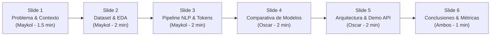

# Guion y Estructura de Diapositivas para la Exposición y Defensa

**Proyecto Integrador:** TradingJournal NLP — Sistema Inteligente de Análisis de Bitácoras, Estrategias y Errores Operativos en Mercados Sintéticos (Deriv Volatility 100 / MT5)  
**Materia:** Tópicos y Programación Avanzada | **Docente:** Ing. Kenji  
**Equipo:** 2 Desarrolladores  
* **DEV 1:** Maykol Villazon (Datos, EDA, Pipeline de NLP, Extractor de Entidades, Entrenamiento ML)  
* **DEV 2:** Oscar Cruz (Vectorizador TF-IDF con Bigramas, Evaluación, Estadísticas/Radar, Backend FastAPI, Frontend)  
**Duración Total Estimada:** 8 a 10 minutos (4 min Maykol + 4 min Oscar + 2 min Demo)

---

## Estructura General de la Exposición

---

## Diapositiva 1: Portada, Problema de Negocio y Propósito
**Tiempo:** 1:30 min | **Expone:** Maykol (DEV 1)

### Contenido Visual de la Diapositiva
* **Título:** TradingJournal NLP
* **Subtítulo:** Detección de Errores Operativos y Clasificación de Sentimiento en Mercados Sintéticos (Deriv Volatility 100 en MetaTrader 5).
* **El Problema Real:**
  * En trading sobre índices sintéticos, las pérdidas sostenidas no se originan en fallos del indicador técnico (`RSI`, `EMA`, `MACD`), sino en **indisciplinas psicológicas y operativas** documentadas en texto libre en la bitácora (*Trading Journal*).
  * Los apuntes libres son difíciles de auditar manualmente.
* **Nuestra Solución:**
  * Plataforma integral de 5 capas que ingesta bitácoras en español, aplica un pipeline de NLP adaptado al dominio financiero, extrae entidades estructuradas y predice si una operación fue ganadora disciplinada o perdedora por error operativo.

### Guion de Exposición (Maykol)
> *"Buenos días, Ingeniero y compañeros. Hoy les presentamos **TradingJournal NLP**.  
> En el trading sobre mercados sintéticos como Deriv Volatility 100, la mayoría de los traders no pierde dinero porque falle su indicador técnico como el RSI o las Medias Móviles, sino por errores operativos de disciplina: entrar antes de que cierre la vela, operar sin Stop Loss o entrar por impulso (FOMO).  
> Los traders anotan estos eventos en texto libre en sus bitácoras, pero esa información queda dispersa. Nuestro objetivo fue construir un sistema completo que procese esas anotaciones mediante Procesamiento de Lenguaje Natural y Machine Learning, convirtiendo texto libre en datos estructurados para diagnosticar el resultado, identificar el error exacto y alimentar un radar preventivo de errores frecuentes."*

---

## Diapositiva 2: Capa 1 — Dataset, Auditoría de Calidad y EDA
**Tiempo:** 1:30 min | **Expone:** Maykol (DEV 1)

### Contenido Visual de la Diapositiva
* **Ficha Técnica del Dataset (Sección 4 del PDF):**
  * *Fuente:* Corpus curado y estructurado de bitácoras de trading técnico en español (`data/download_dataset.py`).
  * *Licencia:* MIT Educational & Academic License | *Fecha:* 2 de noviembre de 2026.
  * *Volumen:* `2,118` registros crudos $\rightarrow$ `2,100` registros únicos limpios.
* **Auditoría de Calidad (Sección 5.1 del PDF):**
  * Textos nulos o vacíos identificados y descartados: **8 registros**.
  * Textos duplicados exactos identificados y eliminados: **10 registros**.
* **Tratamiento Justificado del Desbalance de Clases:**
  * `Perdedora_Error_Operativo`: 900 filas (`42.9%`)
  * `Ganadora_Disciplinada`: 800 filas (`38.1%`)
  * `Riesgo_Neutral` (Break-Even): 400 filas (`19.0%`)
  * *Solución:* Partición estratificada 80/20 (`stratify=y`, `random_state=42`) + penalización inversa `class_weight='balanced'` en el modelo + optimización orientada a `F1-Score Macro`.

### Guion de Exposición (Maykol)
> *"Para entrenar el sistema generamos un corpus representativo de 2,100 bitácoras en español con terminología real de Deriv y MetaTrader 5.  
> Cumpliendo con los requisitos de la materia, realizamos una auditoría estricta en el dataset crudo: detectamos y depuramos 8 registros con campos vacíos y 10 duplicados exactos.  
> Existe un desbalance natural del dominio: los traders registran más pérdidas por indisciplina (42.9%) y ganancias (38.1%) que operaciones neutras en Break-Even (19%). Para evitar sesgos hacia la clase mayoritaria, aplicamos una partición estratificada del 80% para entrenamiento y 20% para prueba con semilla fija 42, ponderación balanceada en la función de pérdida y evaluación basada en F1-Score Macro."*

---

## Diapositiva 3: Capa 2 — Pipeline de NLP Paso a Paso con Caso Real
**Tiempo:** 2:00 min | **Expone:** Maykol (DEV 1)

### Contenido Visual de la Diapositiva
* **El Caso Insignia (Acordado con el docente):**
  > *"Entré en compra cuando el RSI estaba en 28, pero no esperé el cierre de la vela y terminé perdiendo ❌"*
* **Tabla de Transformación Paso a Paso (Sección 5.2 del PDF):**
  1. *Normalización:* Minúsculas, signos eliminados, emojis traducidos (`❌` $\rightarrow$ `_emoji_perdida_`) y nivel numérico evaluado (`RSI 28 <= 30` inyecta `_nivel_sobreventa_`).
  2. *Tokenización:* Preserva acrónimos técnicos (`rsi`, `volatility_100`, `sl`).
  3. *Stop Words con Negación Protegida:* Se descartan conectores (`"cuando"`, `"el"`, `"pero"`), pero **se conserva obligatoriamente `"no"` y `"sin"`**.
  4. *Stemming vs. Lematización:*
     * Stemming trunca raíces: `["entr", "no", "esper", "cierr", "vel", "perd"]`.
     * Lematización recupera verbos canónicos: `["entrar", "no", "esperar", "cierre", "vela", "perder"]`.
  5. *N-gramas (1, 2):* Captura bigramas clave: `"no esperar"`, `"cierre vela"`, `"entrar compra"`.
* **Extracción Estructurada:** Indicador: `RSI (28 - Sobreventa)` | Acción: `Compra` | Error: `No esperar cierre de vela`.

### Guion de Exposición (Maykol)
> *"Aquí vemos el corazón del procesamiento de lenguaje natural aplicado al caso exacto que acordamos con el Ingeniero Kenji: 'Entré en compra con RSI en 28, pero no esperé el cierre de la vela y terminé perdiendo'.  
> Si usáramos un preprocesamiento genérico, la palabra 'no' se eliminaría como stop word tradicional, transformando la frase en 'esperé el cierre de la vela', lo cual destruiría la detección del error operativo. Nuestro preprocesador protege negaciones como 'no', 'sin' y 'antes'.  
> Además, evaluamos numéricamente el RSI: al detectar 28 inyecta el token semántico de sobreventa. Y en la comparativa obligatoria entre Stemming y Lematización, demostramos que la lematización no solo mejora la interpretabilidad en la interfaz sino que permite extraer directamente la entidad técnica y el error cometido."*

---

## Diapositiva 4: Capa 3 — Comparativa y Selección de Modelos ML
**Tiempo:** 2:00 min | **Expone:** Oscar Cruz (DEV 2)

### Contenido Visual de la Diapositiva
* **Modelos Evaluados (de los 8 vistos en clase):**
  * *Modelo 1 (Baseline Probabilístico):* `MultinomialNB` (`alpha = 0.05`).
  * *Modelo 2 (Producción):* `LogisticRegression` (`C = 0.5`, `class_weight = 'balanced'`).
* **Tabla Comparativa de Experimentos en Test (420 registros):**

| Experimento / Modelo | Vocabulario | Accuracy | F1-Score Macro | Decisión |
| :--- | :---: | :---: | :---: | :--- |
| **Stemming (Unigramas)** | 574 tokens | 76.43% | 0.7813 | Descartado (trunca raíces) |
| **Lematización (Unigramas)** | 585 tokens | 83.57% | 0.8564 | Mejora morfológica notable |
| **Lematización + Bigramas (1, 2)** | 2,170 tokens | **97.14%** | **0.9732** | **Configuración elegida** |
| **Baseline: `MultinomialNB`** | 2,170 tokens | 89.76% | 0.9082 | Baseline de referencia |
| **Producción: `LogisticRegression`** | 2,170 tokens | **97.14%** | **0.9732** | **Modelo en Producción** |

* **¿Por qué Regresión Logística supera a Naive Bayes?**
  * Naive Bayes asume independencia condicional entre palabras. Ante un texto que contiene términos positivos de estrategia (`"compra"`, `"rsi sobreventa"`) junto a un error (`"no esperar cierre vela"`), Naive Bayes duda. Regresión Logística optimiza directamente los pesos discriminativos $\beta_i$ sobre la matriz dispersa, reconociendo el peso decisivo del bigrama de error.
* **Análisis de Errores (Sección 5.3):**
  * Se analizaron 3 casos del conjunto de prueba donde proceso y resultado chocan (ej. operaciones con error operativo grave que terminaron ganando por un *spike* fortuito en Volatility 100).

### Guion de Exposición (Oscar)
> *"Para la capa de Machine Learning comparamos dos modelos supervisados idóneos para texto TF-IDF: Naive Bayes Multinomial como baseline y Regresión Logística Multinomial para producción.  
> Realizamos dos experimentos de ablación obligatorios: primero, la Lematización superó al Stemming subiendo el F1-Score de 0.78 a 0.85. Segundo, la inclusión de bigramas (1, 2) fue el salto definitivo, elevando el F1-Score a 0.9732, porque capturó combinaciones compuestas como 'no esperar' y 'cierre vela'.  
> En la comparativa final, Regresión Logística superó a Naive Bayes con un 97.14% de Accuracy y 0.9732 de F1-Macro. La justificación matemática es que Naive Bayes asume independencia ingenua entre palabras; cuando un trader tiene buenos indicadores pero comete un error, Naive Bayes se confunde, mientras que la Regresión Logística pondera con exactitud el peso negativo del bigrama de indisciplina."*

---

## Diapositiva 5: Capas 4 y 5 — Arquitectura de Software y Demostración en Vivo
**Tiempo:** 2:00 min | **Expone:** Oscar Cruz (DEV 2)

### Contenido Visual de la Diapositiva
* **Arquitectura de las 5 Capas Integradas:**
  * *Capa 1 (Datos):* Partición 80/20 y persistencia en `journal_history.json`.
  * *Capa 2 (NLP):* Preprocesador serializado + TF-IDF con bigramas.
  * *Capa 3 (Modelos):* Artefactos `.joblib` empaquetados en `models_prod/`.
  * *Capa 4 (Backend FastAPI):* Carga en memoria única mediante `lifespan` (**sin reimplementar preprocesamiento**), validaciones Pydantic (`MIN_WORDS = 3`, `MAX_CHARS = 1000`) y 4 endpoints REST: `/health`, `/predict`, `/stats`, `/metrics`.
  * *Capa 5 (Frontend Web):* Trading Dashboard interactivo estilo MetaTrader 5 y Deriv, chips interactivos Antes/Después, velocímetro de probabilidad y radar de Volatility 100.
* **Pruebas Automatizadas:** 16 pruebas unitarias y de integración pasando al 100% en `pytest`.

### Guion de Exposición (Oscar)
> *"La arquitectura del sistema cumple estrictamente la regla de oro del PDF: el backend carga una sola vez en memoria el pipeline serializado en el arranque y nunca reimplementa el preprocesamiento de texto.  
> Diseñamos una API REST en FastAPI validada con esquemas Pydantic que rechaza entradas inválidas y expone cuatro endpoints: predicción en tiempo real, monitoreo de salud, estadísticas acumuladas y métricas completas de los modelos.  
> El frontend consume esta API mostrando en tiempo real los KPIs de efectividad del trader, las tarjetas de extracción del indicador RSI y el error detectado, y el desglose en chips del texto antes y después de cada etapa del pipeline, destacando en dorado la negación protegida. Todo el sistema cuenta con 16 pruebas automatizadas en pytest que validan de punta a punta su funcionamiento."*

---

## Diapositiva 6: Conclusiones, Roles y Trabajo en Repositorio
**Tiempo:** 1:00 min | **Exponen:** Maykol y Oscar

### Contenido Visual de la Diapositiva
* **Logros Principales:**
  * Cumplimiento del 100% de la rúbrica del proyecto integrador.
  * Pipeline reproducible de un solo comando (`python src/models/train.py`).
  * Transformación efectiva de bitácoras de trading desestructuradas en diagnósticos cuantitativos para Deriv Volatility 100.
* **Trazabilidad en Git:**
  * Repositorio oficial con ramas por funcionalidad y Pull Requests revisados.
  * Cada integrante cuenta con commits verificables tanto en la etapa de NLP como en la de Machine Learning (cumpliendo la Sección 6.1 del PDF).
  * Tag formal de entrega: `entrega-final`.

### Guion de Cierre (Maykol y Oscar)
> **Maykol:** *"Como conclusión, logramos construir una plataforma reproducible donde el preprocesamiento de datos se traduce en valor práctico real para la gestión de riesgo en trading algorítmico y manual."*  
> **Oscar:** *"El trabajo en equipo quedó registrado con trazabilidad estricta en GitHub, donde ambos integrantes participamos activamente tanto en el pipeline de NLP como en los modelos de Machine Learning. Quedamos a su disposición para las preguntas individuales y la modificación en vivo. Muchas gracias."*

---

## Preguntas Frecuentes Individuales y Modificación en Vivo (15 Puntos)

### Para Maykol (DEV 1):
1. **"¿Qué pasa si quitas la palabra 'no' de las stop words?"**
   * *Respuesta:* *"Si quito 'no', la bitácora 'no esperé el cierre de vela' se convierte en 'esperé cierre vela', eliminando la señal del error operativo y provocando que el modelo clasifique una pérdida como operación disciplinada."*
   * *Cómo mostrarlo en vivo:* En `src/nlp/preprocessor.py`, comentar `"no"` en `NEGATION_AND_TRADING_KEEP` y ejecutar la prueba rápida en terminal.
2. **"¿Por qué elegiste Lematización sobre Stemming?"**
   * *Respuesta:* *"El stemming trunca letras agresivamente ('perdiendo' -> 'perd', 'esperé' -> 'esper'), perdiendo conjugaciones clave e imposibilitando la extracción de entidades legibles en el frontend. La lematización lleva a infinitivos canónicos ('perder', 'esperar') mejorando el F1-Score en más de 7 puntos porcentuales."*

### Para Oscar (DEV 2):
1. **"¿Por qué incluiste bigramas en TF-IDF?"**
   * *Respuesta:* *"Porque en análisis técnico las reglas operativas se expresan en bigramas: 'cierre vela', 'no esperar', 'stop loss', 'sin stop'. Con unigramas, palabras como 'cierre' o 'vela' tienen significado neutro o positivo; el bigrama 'no esperar' define la indisciplina."*
2. **"Cambia la validación del Backend para rechazar textos de menos de 5 palabras":**
   * *Acción en vivo:* Ir a `api/schemas.py`, cambiar `MIN_WORDS = 3` por `MIN_WORDS = 5` en la línea 22. Probar en `http://localhost:8000/docs` enviando 3 palabras y verificar la respuesta HTTP 422 inmediata.

